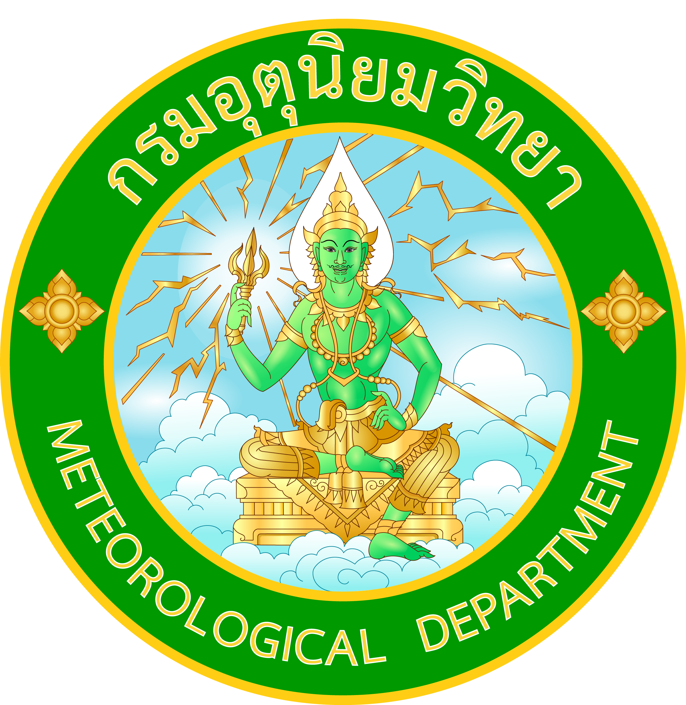

# Thai Meteorological Department (TMD) for Home Assistant



A UI-configured custom integration using official Thai Meteorological Department
(กรมอุตุนิยมวิทยา) NWP coordinate APIs. Domain: `tmd_weather`.

[](https://my.home-assistant.io/redirect/hacs_repository/?owner=atomiilol&repository=TMD_weather_HomeAssistant&category=integration)

**Experimental: authenticated NWP forecasts have not been verified.** Official
TMD documentation is now accessible. The parser is tested against its hourly and
daily examples, and public observation examples returned live data. No private
NWP token was available, so forecast fixtures remain documentation examples and
synthetic test data. See [verification notes](docs/research.md).

Current weather uses **actual Weather3Hours station observations when separate
observation credentials are supplied**. Without those optional credentials, it
uses explicitly modeled NWP estimates. The selected source is disclosed in setup,
device information and diagnostics and never changes silently during outages.

## Features

- One `weather` entity per coordinate: station temperature, humidity, sea-level
  pressure, wind, visibility and dew point when observation access is configured;
  otherwise modeled current conditions.
- Hourly forecasts (up to 48 hours) and daily forecasts (up to 7 days), including
  rainfall amounts and daily high/low temperatures.
- One rainfall sensor: **Station rainfall** or **Modeled rainfall this hour**,
  according to the configured current source; never a cumulative counter or probability.
- Separate sensors for temperature, humidity, sea-level pressure, wind speed,
  wind direction, dew point and visibility, plus today's forecast high/low
  temperatures and rainfall. All share the existing weather/forecast caches.
- UI setup using HA's coordinates by default, duplicate detection, reauthentication,
  English/Thai translations and redacted diagnostics.
- Bounded async requests, rate-limit backoff and recovery from temporary failures.

Requires **Home Assistant 2026.10.1 or later** and its Python 3.14 runtime.
Tested with Home Assistant 2026.10.1 / Python 3.14.8. Earlier versions are not
supported: this uses current `probatio` secret fields, typed runtime data and
timestamped weather coordinators. Future releases still need compatibility testing.

## Separate sensor entities

Each configured location has one weather entity and sensors for the measurements
TMD supplies. A full station dataset provides eleven sensors; modeled weather
normally provides nine because its source has no dew point or visibility.
Use the sensors directly in dashboards, automations and history, as with
AccuWeather's separate measurement entities. Find them under **Settings → Devices
& services → Thai Meteorological Department (TMD)** and open your location's device.

| Sensor | Native unit | Source |
| --- | --- | --- |
| Temperature | °C | Configured current source |
| Humidity | % | Configured current source |
| Sea-level pressure | hPa | Configured current source |
| Wind speed | m/s | Configured current source |
| Wind direction | ° | Configured current source |
| Dew point | °C | Station observations only |
| Visibility | km | Station observations only |
| Station rainfall / Modeled rainfall this hour | mm | Configured current source |
| Forecast high temperature today | °C | Daily NWP forecast |
| Forecast low temperature today | °C | Daily NWP forecast |
| Forecast rainfall today | mm | Daily NWP forecast |

Current sensors use the same station or modeled values as the weather entity.
Their `data_source` attribute identifies `station` or `nwp_model`; they never switch
sources during outages. Dew point and visibility sensors are omitted without
station observations. New optional sensors are added only after TMD supplies
values, including when they first appear in a later update. Missing readings on
previously supported sensors, expired data or a failed update make those sensors
**unavailable**, while preserving their IDs for recovery.

Forecast sensors explicitly identify `nwp_forecast` and a `forecast_date`. "Today"
uses Thailand's **Asia/Bangkok** calendar. A daily forecast failure affects these
three sensors independently of current conditions. Forecasts and rainfall amounts
do not collect cumulative or measurement statistics; current measurement sensors
use Home Assistant's measurement statistics, including circular wind-direction
statistics. Home Assistant handles supported display-unit conversions.

Upgrading to 0.3.0 automatically removes old dew point/visibility placeholders
from modeled locations. Your location configuration, weather entity, forecasts
and supported sensor IDs are preserved. The weather entity can still show an
unknown sky condition when TMD supplies no condition code. Disable any unwanted
supported sensors using Home Assistant's entity controls.

## Configure the fetch interval

1. Open **Settings → Devices & services → Thai Meteorological Department (TMD)**.
2. Select **Configure** for the location you want to change.
3. Set **Weather fetch interval (minutes)** to a whole number from **1 to 1440**.
4. Select **Submit**. The setting takes effect automatically; it also survives
   Home Assistant restarts. You do not need to re-enter credentials.

The interval applies to current conditions and active hourly/daily forecast
polling. Sensors share those caches, so each sensor does not make its own request.
Until you save an interval, the original defaults remain: modeled/hourly data
every 60 minutes, station observations every 30 minutes, and daily forecasts every
180 minutes. The options dialog starts at 60 minutes for modeled locations or 30
minutes for station locations. Saving a value sets that same interval for all
active datasets. Hourly forecasts in station mode also refresh on demand when no
dashboard subscribes to them.

Polling more often does not make TMD publish fresh data sooner. Authentication
handling, request timeouts and the existing server rate-limit backoff continue to
apply at every interval.
Cached modeled values still advance as the model hour changes, and expired station
measurements become unavailable between fetches. These checks make no API requests.

## Installation

### HACS custom repository (recommended)

Install and configure [HACS](https://www.hacs.xyz/docs/use/) first. This repository
is installed as a **custom repository**; default-store listing is not claimed.
The repository changes must be published on GitHub before HACS can download them.

1. Open **HACS** in Home Assistant.
2. Select the **three-dot menu** at the top right, then **Custom repositories**.
3. Enter `https://github.com/atomiilol/TMD_weather_HomeAssistant`.
4. Select **Integration** as the type, then **Add**.
5. Search the HACS dashboard for **Thai Meteorological Department (TMD)** and open it.
6. Select **Download** and confirm the version. The latest compatible published
   release is recommended; HACS can use the default branch before the first release.
7. Restart Home Assistant, then complete the configuration below.

The button above opens the supported My Home Assistant HACS repository link. It
helps you find/add the repository; confirm the HACS download before restarting.
These steps follow the current HACS dashboard UI, without the obsolete instruction
to open a separate Integrations tab.

### Manual installation

1. Copy the entire `custom_components/tmd_weather` directory to
   `/config/custom_components/tmd_weather/`. That directory must directly contain
   `manifest.json`, the Python modules, `brand/` and `translations/`.
2. Restart Home Assistant.

### Configure after either installation method

1. Open **Settings → Devices & services → Add integration** and search for
   **Thai Meteorological Department (TMD)**.
2. Enter your NWP bearer token and check the default Home Assistant coordinates.
3. To use physical station observations, supply both optional **Observation API
   uid** and **Observation API ukey** fields. They are separate from the NWP token.
   Leave both empty to choose modeled current conditions explicitly.
4. Submit. Setup validates forecasts and the selected current source before
   creating entities. No integration YAML is needed.

HACS installs/updates files only. A manually installed copy has identical behavior
and does not require HACS at runtime.

The main entity uses the location/device name, typically `weather.home`.
Coordinates default to Home Assistant's location; other coordinates use a
coordinate-based title. Thai names work. Rename devices through HA as usual.
Changing a name does not move its source location: remove and re-add the entry
to change coordinates. Use the integration menu in **Devices & services** to remove it.

## Credentials

Forecasts require an **NWP bearer access token**, sent as
`Authorization: Bearer <token>` to fixed HTTPS NWP endpoints. Enter just the token,
without `Bearer `. Legacy `uid` / `ukey` credentials are a different scheme.

Following TMD's [official getting-started guide](https://data.tmd.go.th/nwpapi/doc/main/getting_start.html):

1. [Register for NWP access](https://data.tmd.go.th/nwpapi/register), providing the
   information and purpose requested by TMD.
2. [Log in](https://data.tmd.go.th/nwpapi/login).
3. Under **Personal Access Tokens**, select **Create New Token** and give it a
   recognizable name.
4. Copy the token immediately: TMD says it is displayed only once. Enter it in
   the integration's secret token field.

The documentation calls this OAuth 2.0 but explicitly supports token creation
through its website only. It does not document an authorization-code/refresh-token
grant or a fixed token lifetime. Manual personal tokens and HA reauthentication
therefore match the documented flow. Registration and login pages returned
HTTP 200 during verification, without creating an account.

An HTTP 401/403 starts HA reauthentication. A replacement token is validated and
the same location entry is reloaded. Credentials stay in HA config-entry storage;
they are excluded from entity attributes, device identifiers, integration
logs and diagnostics. Treat configuration backups as sensitive.

### Separate station-observation credentials

Weather3Hours uses legacy **uid/ukey query authentication over HTTPS**, documented
in TMD's [Weather3Hours reference](https://data.tmd.go.th/api/doc/reference/Weather3Hours_ver2.pdf).
These credentials cannot be exchanged for an NWP bearer token. Use your assigned
observation credentials. TMD's [API catalog](https://data.tmd.go.th/api/index1.php)
also publishes example-access links that worked during verification; their access
is not guaranteed permanently and no demo key is hard-coded in this integration.
A separate legacy credential-issuance/refresh process is not documented in the
sources inspected; contact TMD if assigned access is required.

The observation protocol necessarily sends uid/ukey in the HTTPS request query.
The integration suppresses request URLs and raw errors in its own logs/diagnostics;
avoid enabling external HTTP tracing that might record those queries. NWP tokens
are sent only in headers.

To add, replace or disable station access later, use the integration entry's
**Reconfigure** action. Toggle **Use station observations** and provide the
credential pair when enabling it. Existing coordinates, configuration and entity
IDs are preserved. Reauthentication can replace the NWP token and/or legacy pair.

## Sources, polling and time

| Dataset | Official source | Implementation |
| --- | --- | --- |
| Current station weather | `https://data.tmd.go.th/api/Weather3Hours/V2/` | Nearest fresh station; 30-minute default, configurable |
| Modeled current weather | Current NWP hourly timestep | Used only when observation credentials are absent |
| Hourly forecast | `https://data.tmd.go.th/nwpapi/v1/forecast/location/hourly/at` | Request 48 hours; 60-minute default, configurable; on demand without subscribers |
| Daily forecast | `https://data.tmd.go.th/nwpapi/v1/forecast/location/daily/at` | Request 7 days; 180-minute default, configurable; on demand when stale |
| Other observations | WeatherToday / station catalog | Researched; Weather3Hours already includes the metadata needed for station selection |

Observed current conditions use a separate coordinator from hourly/daily forecasts.
Either forecast can fail while observed weather remains available. An observation
failure makes current weather unavailable and retains the last cache for recovery;
it never silently substitutes an NWP estimate. All configured datasets must pass
their first refresh. In modeled mode, current conditions share the hourly cache.

Station selection filters missing/invalid temperatures, coordinates and timestamps,
chooses the closest usable station within **100 km**, and rejects observations
older than **6 hours** or dated in the future. These are integration safety policies,
not TMD coverage guarantees. Equal-distance ties use the WMO ID. A removed/stale
station is replaced by the next nearest valid one using the same dataset, without
moving the forecast coordinate or changing entity IDs. No separate station-list
download is needed on every refresh.

Fresh attribute/forecast reads make no extra request. With entities enabled and a
daily subscriber, default scheduled traffic is about 24 hourly + 8 daily requests
per day, plus validation/setup, manual refreshes and failure retries. These are
conservative polling choices, independent of model publication cadence. TMD's guide
documents **60 requests/minute and 100,000 datapoints/hour**, where datapoints are
locations × duration × fields. Its later header descriptions inconsistently say
"hour" for the request limit, so deployments should honor actual server limits.
Observation mode adds approximately 48 observation requests/day by default; its quota is not
specified in the inspected legacy reference. HA handles retries. NWP HTTP 429
honors `Retry-After` for both forecast endpoints of that entry;
an absent/invalid header defaults to one hour. The client never loops or sleeps.

Request dates/hours use `Asia/Bangkok`, independent of HA/server timezone.
Responses must contain timezone-aware timestamps. Current model data is selected
only from `time <= now < time + 1 hour`; future/expired points are never presented
as current. That interval interpretation still needs live TMD confirmation.
Diagnostics distinguish forecast **valid times** from fetch times; no model
issuance time is invented.

Live Weather3Hours JSON uses numeric strings and `MM/DD/YYYY HH:MM:SS` timestamps.
The parser handles them explicitly in Bangkok time, confirmed across the
October 11/12 rollover. It does not mistake them for the offset-aware NWP format.

## Field mapping

| TMD | Home Assistant | Native units / behavior |
| --- | --- | --- |
| `tc` | Current/hourly `native_temperature` | °C; current is modeled |
| `tc_max` | Daily `native_temperature` | °C |
| `tc_min` | Daily `native_templow` | °C |
| `rh` | `humidity` | % |
| `slp` | `native_pressure`, including forecasts | hPa |
| `rain` | Forecast `native_precipitation`; modeled-rain sensor | mm, never probability |
| `ws10m` | `native_wind_speed` | m/s; HA handles display conversions |
| `wd10m` | `wind_bearing` | degrees |
| `cond` | `condition` | Mapping below |
| `cloudlow/med/high` | Not requested/exposed | No verified total; layers overlap |
| `psfc` | Not requested | Do not confuse surface Pa with sea-level hPa |
| `swdown` | Not requested/exposed | Shortwave radiation is not UV index |

| Weather3Hours field | Current HA value | Native units |
| --- | --- | --- |
| `AirTemperature` | `native_temperature` | °C |
| `RelativeHumidity` | `humidity` | % |
| `MeanSeaLevelPressure` | `native_pressure` | hPa |
| `WindSpeed` | `native_wind_speed` | Source km/h normalized to m/s to share the weather entity's wind unit with NWP forecasts |
| `WindDirection` | `wind_bearing` | degrees |
| `LandVisibility` | `native_visibility` | km |
| `DewPoint` | `native_dew_point` | °C, supplied directly; never derived |
| `Rainfall` | Station rainfall sensor | mm; accumulation-window alignment is not independently verified |

Current rainfall uses a sensor because HA's current-weather entity has no
`native_precipitation` property; forecast dictionaries do. Missing/null/invalid
optional values are not fabricated. Sensors omit unsupported fields and mark
temporarily missing readings unavailable. NWP booleans, numeric strings and nonfinite numbers
are not treated as JSON numeric measurements; legacy numeric strings are parsed
according to the verified observation schema. Missing structure, timezone offsets,
duplicate times or an entirely unusable temperature series fail the update.

| TMD condition | HA condition |
| --- | --- |
| 1 — clear | `sunny` |
| 2 — partly cloudy | `partlycloudy` |
| 3 / 4 — cloudy / overcast | `cloudy` |
| 5 / 6 — light / moderate rain | `rainy` |
| 7 — heavy rain | `pouring` |
| 8 — thunderstorm | `lightning-rainy` |
| 9–12 — temperature descriptions | Unknown (`None`) |
| Missing/unknown | Unknown (`None`) |

These are valid current HA constants, and the TMD meanings/units are confirmed by
the official hourly/daily field tables. Clear conditions use `sunny`;
astronomical day/night refinement is not implemented. No sky condition is inferred
from temperature alone.

**Weather3Hours supplies no sky-condition code.** In station mode the current
condition/icon can therefore be unknown even while temperature and other
measurements are available. Forecast icons still use verified NWP condition codes.
The integration does not borrow a forecast icon and label it as an observation.

## Limitations and troubleshooting

- Authenticated production NWP responses, account-specific limits, geographical
  coverage, exact rainfall interval alignment and model publication schedules
  remain unverified. Official endpoint/auth/schema/field documentation is verified.
- Total cloud cover, apparent temperature, UV, precipitation probability, warnings
  and radar are not exposed without a verified source. Visibility/dew point are
  available only from station observations.
- Unknown icons with valid measurements are expected when `cond` only describes
  temperature or is missing/unrecognized.
- **Cannot connect:** check Internet/DNS and HTTPS access to `data.tmd.go.th`.
  Requests time out after 10 seconds.
- **Invalid authentication:** use an NWP token, not a legacy key pair. HA starts
  reauthentication automatically for authentication failures during updates.
- **Rate limited:** wait. Manual refreshes do not bypass the existing client's cooldown.
- **Invalid response:** data may be absent or the schema may differ. Download
  redacted integration diagnostics and report the issue. Never post tokens or
  raw authenticated requests.
- **Service unavailable / HTTP 404:** an endpoint may have changed; it is not
  silently treated as a bad token or replaced with fabricated data.
- Change polling through the integration's **Configure** button. Disable unwanted
  supported sensors through HA's entity controls.

## Updates through HACS

Published GitHub Releases make new versions available through normal HACS update
checks. Open the Home Assistant update notification, read the release notes and
select **Install**, or use HACS's **Pending update → Redownload** action. Restart
Home Assistant after updating. Do not remove/re-add the integration for ordinary
upgrades: HA stores config entries/entity IDs separately from the downloaded files.

Release compatibility is declared in `hacs.json`; a future data-schema change
must include a config-entry migration. See [changelog](CHANGELOG.md) and
[release procedure](docs/releases.md).

Download published versions from [GitHub Releases](https://github.com/atomiilol/TMD_weather_HomeAssistant/releases/latest).
HACS uses the latest published release tag as the available version. Future
`vX.Y.Z` tags automatically publish a release after version checks, tests, HACS
validation and Hassfest pass. A commit to `main` alone does not publish an update.
If HACS has not refreshed yet, open this repository in HACS and use **Update
information** from its menu, then install the offered version and restart Home
Assistant. Users tracking `main` can select a published version through
**Redownload** to follow release updates instead.

## Development

Use the existing checkout; cloud tasks already have an isolated workspace and
do not need a new Git worktree. With [uv](https://docs.astral.sh/uv/) installed:

```sh
uv sync --frozen --group dev
uv run --frozen pytest tests/components/tmd_weather --cov --cov-report=term-missing
uv run --frozen ruff check custom_components tests script
uv run --frozen ruff format --check custom_components tests script
uv run --frozen mypy custom_components/tmd_weather script/check_release.py
uv run --frozen python script/check_release.py --tag v0.3.0
```

`uv.lock` pins development dependencies, including HA 2026.10.1. Tests use real
HA flows/platforms/services with `pytest-homeassistant-custom-component` and mocked
HTTP; outbound sockets are disabled. No actual TMD credential is needed.
See [fixture provenance](tests/components/tmd_weather/fixtures/README.md) and
[architecture/verification notes](docs/research.md). CI runs the same checks.

```text
custom_components/tmd_weather/
├── __init__.py
├── api.py
├── observations.py
├── brand/                   # Supplied TMD emblem as local icon/logo assets
├── config_flow.py
├── const.py
├── coordinator.py
├── diagnostics.py
├── icons.json
├── manifest.json
├── sensor.py
├── strings.json
├── weather.py
└── translations/
    ├── en.json
    └── th.json
tests/components/tmd_weather/
├── conftest.py
├── fixtures/                 # Synthetic hourly/daily contract examples
├── test_api.py
├── test_config_flow.py
├── test_coordinator.py
├── test_diagnostics.py
├── test_end_to_end.py
├── test_init.py
├── test_metadata.py
├── test_observations.py
├── test_release.py
└── test_weather.py
docs/research.md
docs/hacs.md
docs/releases.md
CHANGELOG.md
hacs.json
script/check_release.py
pyproject.toml
uv.lock
.github/workflows/            # tests, HACS, hassfest, release version checks
```

## Attribution

Provider: **Thai Meteorological Department — กรมอุตุนิยมวิทยา**.
This community integration does not claim official TMD or HA Core endorsement.

- [Official website](https://www.tmd.go.th/)
- [Official API directory](https://data.tmd.go.th/api/index1.php)
- [NWP hourly documentation](https://data.tmd.go.th/nwpapi/doc/apidoc/location/forecast_hourly.html)
- [NWP daily documentation](https://data.tmd.go.th/nwpapi/doc/apidoc/location/forecast_daily.html)
- [AccuWeather architecture reference (current dev)](https://github.com/home-assistant/core/tree/dev/homeassistant/components/accuweather)

Code uses the repository's [MIT license](LICENSE). That does not establish
redistribution rights for TMD data; consult TMD's current service terms.
