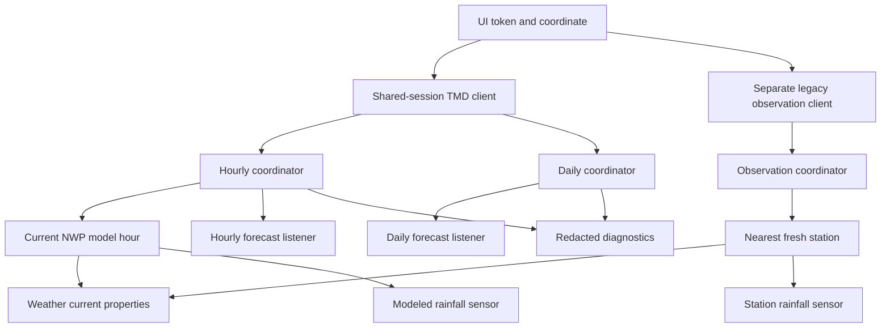

# Architecture and verification record

These notes document the earlier NWP/Weather3Hours investigation. Current stable
AWS setup and behavior are documented in [AWS stations](aws-stations.md).
Observation UID/UKEY fields have been retired from configuration dialogs.

Research dates: 2026-10-11–12. TMD documentation and public observation examples are
now accessible; authenticated NWP forecast payloads remain unverified.

## Architecture decision

- **Current source:** nearest fresh Weather3Hours station when a separate uid/ukey
  pair is configured. Without that pair, explicit current-hour NWP estimates.
  Source changes require UI reconfiguration; outages never silently change it.
- **Forecast sources:** verified official HTTPS `location/hourly/at` and
  `location/daily/at` coordinate endpoints, isolated behind `api.py`. An optional
  source explicitly selects Domain 2 on `forecast/area/box`, with a small area
  request and nearest-point distance capped at 3 km. Daily data remains separate.
- **Authentication:** documented NWP bearer contract, user-entered token, shared HA
  aiohttp session, no redirects. No refresh grant is invented; observation
  credentials are not assumed interchangeable.
- **Polling:** default observations 30 minutes, hourly 60 minutes and daily 180
  minutes; a per-location options flow sets an interval of 1–1440 whole minutes
  for active datasets. Model publication cadence is not established.
  Server Retry-After takes precedence; no custom retry loops.
- **Identity:** requested latitude/longitude to four decimals, signed zero
  normalized, independent of name/token/model-grid changes. About 11 m latitude
  precision is a duplicate-detection choice, not a model-resolution claim.
- **Conditions:** codes 1–8 map to current HA constants; 9–12 and unknown stay
  unknown. No invented sky conditions or cloud-layer totals.

`entry.runtime_data` owns independent forecast coordinators and an optional
observation coordinator. `CoordinatorWeatherEntity` follows the selected current
source, with forecasts updating independently. No runtime code imports HACS.
First refreshes are sequential and required for both advertised types, preventing
a second initial request after a 401/429. Later daily failures are independent.
Hourly refreshes always notify: the active model hour advances even if the entire
forecast document remains identical.

The HA-independent API layers return immutable dataclasses. Weather3Hours includes
both metadata and observations, so a separate station catalog request is unnecessary
on each poll. Selection rejects future/over-six-hour-old observations, filters
unusable stations and chooses the nearest within 100 km, breaking ties by WMO ID.
These age/distance thresholds are documented integration policies. Removed or
stale stations are reselected on the next update, preserving configured coordinates
and entity IDs. The live JSON parser and real client were verified against TMD.

## Home Assistant research: verified

Inspected current `home-assistant/core` **dev**:

- AccuWeather `__init__.py`, `config_flow.py`, `const.py`, `coordinator.py`,
  `weather.py`, `sensor.py`, `diagnostics.py`, `system_health.py`, `manifest.json`,
  `strings.json`, `icons.json`.
- AccuWeather `conftest.py`, `test_config_flow.py`, `test_init.py`,
  `test_weather.py`, `test_diagnostics.py`.
- Weather entity source: `Forecast`, `CoordinatorWeatherEntity`, timestamped
  refreshes, native fields and forecast listener lifecycle.
- Met.no and OpenWeatherMap weather implementations as additional maintained examples.
- Current Python requirements and unit constants; tested against published
  HA 2026.10.1 on Python 3.14.8.
- [Current quality scale source](https://github.com/home-assistant/developers.home-assistant/blob/master/docs/core/integration-quality-scale/index.md),
  rules overview, config-flow rule and test-coverage rule. Its official GitHub
  source was accessible despite the rendered documentation site's block.

Current conventions used: `probatio.Schema` / `probatio.Secret`, typed config
entry runtime data, `TimestampDataUpdateCoordinator`, `_async_forecast_*`
callbacks, native pressure in forecast dictionaries, separate rainfall sensor
because current weather has no rainfall property, and the new entry-specific
`async_get_device_by_identifier` lookup in tests.

No custom system-health module is added: diagnostics cover cache health without
additional network requests. No arbitrary options, duplicate
measurement sensors or warning entities are added. HA's existing reauth flow
handles authentication repairs. No official quality tier is claimed.

## TMD research: access restored and official documentation verified

The earlier proxy denial is resolved. The following returned HTTP 200 on retry:

- [NWP documentation](https://data.tmd.go.th/nwpapi/doc/)
- [Authentication and getting started](https://data.tmd.go.th/nwpapi/doc/main/getting_start.html)
- [Hourly coordinate forecast](https://data.tmd.go.th/nwpapi/doc/apidoc/location/forecast_hourly.html)
- [Daily coordinate forecast](https://data.tmd.go.th/nwpapi/doc/apidoc/location/forecast_daily.html)
- [API catalog](https://data.tmd.go.th/api/index1.php)
- [Registration](https://data.tmd.go.th/nwpapi/register) and
  [login](https://data.tmd.go.th/nwpapi/login); no account was created.
- [Weather3Hours reference, updated June 2024](https://data.tmd.go.th/api/doc/reference/Weather3Hours_ver2.pdf)
  and [station reference](https://data.tmd.go.th/api/doc/reference/Station.pdf).

An unauthenticated HTTPS NWP hourly coordinate request returned HTTP **401** with
`{"error":"Unauthenticated."}`. No private NWP token was available, so this proves
endpoint reachability and an authentication requirement, not successful forecasts.

TMD's guide explicitly describes website-only OAuth personal access tokens:
register, log in, select **Create New Token**, name it, and copy it when shown.
The token is displayed only once. No refresh-token grant or fixed lifetime is
documented; manual tokens and reauthentication are appropriate for this contract.

### Documented schema discrepancy and correction

The getting-started guide uses `WeatherForecasts`, the hourly coordinate example
uses the misspelled `WeatherForcasts`, and the daily coordinate example uses
`weather_forecast.locations`. The parser now supports all three **documented**
envelopes. The original daily parser would have rejected the official daily
example; that is fixed and covered by regression tests using exact JSON examples.
These examples are dated 2017 and must not be represented as fresh production
forecasts. Some other introductory sample URLs also omit `/location/`; the
implementation uses the URLs specified on the endpoint-specific pages.

### Live observation-service checks

The API catalog publishes example access URLs for Weather3Hours, WeatherToday and
Station. Read-only checks of their HTTPS equivalents each returned HTTP **200**
and **126 stations**, using only the public example access supplied by TMD.
No private user credentials were used or added to the integration.

- Weather3Hours returned current-date observations, including `AirTemperature`,
  `DewPoint`, `RelativeHumidity`, `MeanSeaLevelPressure`, `LandVisibility`,
  `WindDirection`, `WindSpeed`, `Rainfall` and `Rainfall24Hr`.
- Observation wind is explicitly **km/h**, unlike NWP's **m/s**. Pressure is hPa,
  visibility km, rainfall mm and temperature Celsius.
- The live XML has `Observation.DateTime` such as `10/11/2026 19:00:00`, without a
  timezone offset. JSON uses the same local date format. The adapter parses
  `MM/DD/YYYY HH:MM:SS` in Bangkok time, confirmed against the header across the
  October 11/12 rollover, separately from the offset-required NWP parser.
- The reference lists observations at 01:00, 04:00, 07:00, 10:00, 13:00, 16:00,
  19:00 and 22:00. It documents `format=json` as an alternative to XML. Only the
  live XML and JSON forms have now been checked.
- WeatherToday reports the daily 07:00 observation. Its live XML flattens
  observation fields under `Observation`, differing from the nested static XML
  template. A parser must follow real responses.
- Station metadata includes WMO codes, Thai/English station names, coordinates,
  station type and elevations.
- An unauthenticated Weather3Hours request returned HTTP 200 with an empty body;
  HTTP success alone is not evidence of valid observation access.

These APIs use separate legacy `uid`/`ukey` query authentication. Their public
example access demonstrates availability, not a guarantee of permanent production
credentials or a documented legacy registration/refresh process. Observations
are implemented with an explicit optional credential pair, safe response handling
and a separate coordinator. The integration contains no hard-coded demo credential.
The actual client successfully selected station 48455 (Bangkok) and read its
2026-10-12 07:00 Bangkok-time measurements through the official published example
access. Private production credential issuance/quota guarantees remain unknown.

| Question | Evidence / choice |
| --- | --- |
| NWP header | Bearer + JSON Accept verified in official docs; unauthenticated endpoint returns 401 |
| Signup / token issuance | Verified register/login URLs and website Create New Token workflow |
| Token lifetime | Unknown; no assumption of permanence or local expiry parsing |
| OAuth / refresh grant | Website-only issuance documented; no refresh grant specified; HA reauth supported |
| Observation credentials | Separate legacy uid/ukey documented; published example access works; production credential lifecycle unknown |
| Weather3Hours / WeatherToday | Live HTTPS XML and unit metadata inspected; production quotas/sentinel conventions still unknown |
| Station API | Live metadata inspected; selection uses equivalent Weather3Hours metadata, with no redundant station-list poll |
| Response envelope | All three differing official examples handled and tested; authenticated live NWP payloads still needed |
| Row schema | Official examples confirm `location.lat/lon`, `forecasts[].time`, `forecasts[].data` and JSON numbers |
| Time | Require explicit offsets; use current-hour interval; reject naive dates rather than assume UTC |
| Rain | Hourly rain / 24-hour daily rain and mm units documented; exact interval alignment still needs confirmation |
| Coverage / grid resolution | Newer introduction: Domain 2 is a 3 km hourly grid, Domain 1 is 9 km/three-hourly; older endpoint pages list 2/6/18/27 km. Existing coordinate model mapping is not inferred from `/v1/`. Explicit Domain 2 uses the documented area selector; no guessed country bounds |
| Quota / model cadence | 60 requests/minute and 100,000 datapoints/hour documented; later header prose inconsistently says requests/hour; publication cadence unknown |
| Cloud total / UV / probability | No verified field in the selected NWP endpoints; omitted |
| Visibility / dew point | Exposed directly from Weather3Hours; not calculated |

The coordinate endpoint is assumed to honor the requested coordinate. Multiple
returned locations are reduced to one nearest valid model coordinate using
haversine angular distance with coordinate tie-breakers; their series are never
mixed. This is model-location selection, not observation-station selection.
The existing coordinate source has no guessed maximum forecast-grid distance. The observation adapter's
separate 100 km station radius is an explicit integration policy.

For the optional Domain 2 source, the request and accepted nearest grid point are
bounded to a 3 km search radius. The default coordinate source retains its existing
behavior. This spatial policy is distinct from model grid spacing and from the
observation-station search radius. Probe results on 2026-10-12: guessed `/v2/`
hourly/daily coordinate routes returned 404; the documented `/v1/forecast/area/box`
with `domain=2` returned 401 (`Unauthenticated.`). No private NWP token was available
to verify production responses. UI source changes validate one requested sample
before saving, and mocked HTTP tests cover the entire switch/parser/entity path.

## Before production use

1. Complete an authenticated forecast check with a user-authorized NWP token.
   Documentation access and signup/issuance instructions are now verified.
2. Confirm token lifetime and any updated refresh support directly with TMD.
   Add automatic refresh only if an official suitable contract becomes available.
3. With user-authorized credentials, make read-only forecast calls. Add sanitized
   real fixtures with provenance/capture dates; confirm timestamps, coordinates,
   fields, units and rainfall intervals. Update adapters/tests for discrepancies.
4. Confirm production observation credential lifecycle and quotas with TMD.
   Parsing, date format, units, freshness, source selection and station recovery
   now have live-response evidence and mocked regression tests. Weather3Hours
   does not supply a sky-condition code; current icons remain unknown in station
   mode rather than borrowing the model's condition.
5. Test a live HA install, token expiry, outages and quotas. Mocked tests do not
   establish production TMD compatibility.

## Before a Core submission

- Extract/publish the async client as a versioned library under current Core
  requirements; review TMD terms/data rights.
- Complete production observation support and remaining credential lifecycle checks.
- Review every current quality-scale rule with evidence; no certification is
  claimed for this custom component.
- Add Core documentation/brands metadata, use the Core translation workflow,
  remove custom-only manifest fields, and run full Core tests/lint/types in a Core
  checkout. The official standalone hassfest validator is used for this custom
  component; that does not establish upstream Core acceptance.
